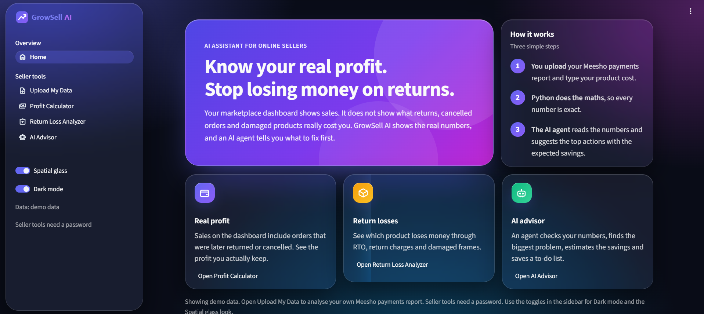
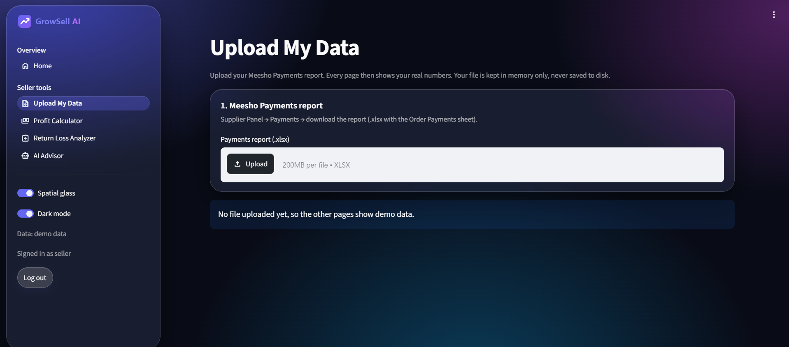
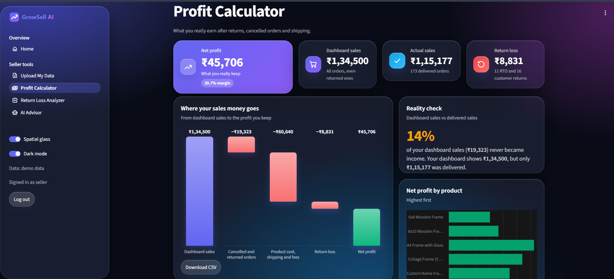
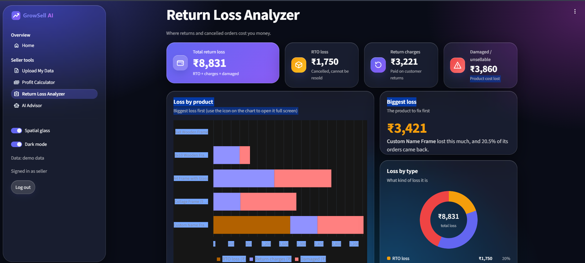
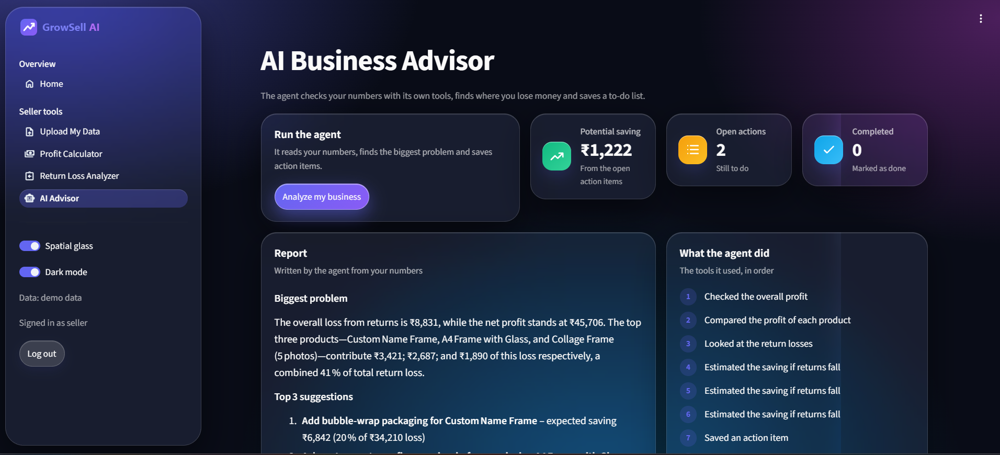
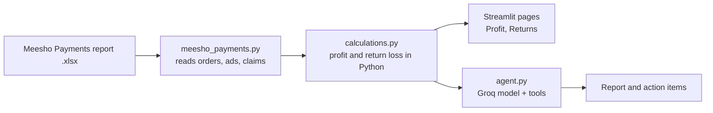

# GrowSell AI

**Know your real profit. Stop losing money on returns.**

An AI agent for online sellers. It reads a Meesho Payments report, shows the profit the seller really keeps, finds where returns and cancelled orders cost money, and tells the seller what to fix first.

**Live demo:** https://growsell-ai-k5lp.onrender.com
(Seller tools are password protected. The free Render plan sleeps when idle, so the first load can take 30–50 seconds.)



---

## The problem

A marketplace dashboard shows **sales**. It does not show what a seller actually keeps after cancelled orders, RTO (orders returned before delivery), return charges, damaged products, shipping, fees and ads.

In my own Meesho shop (October 2026 payments report, 286 orders):

| | |
|---|---|
| Sales on the dashboard | ₹63,886 |
| Cancelled and returned orders | −₹11,392 |
| Product cost, shipping, fees (Meesho deductions) | −₹32,677 |
| Return loss (lost frames and return charges) | −₹7,525 |
| Ads, net of claims | −₹1,127 |
| **Net profit** | **₹11,166** (21.3% of delivered sales) |

Other findings from the same file: 49 of 286 orders came back (about 17%), Meesho charges ₹205 on every customer return, and one product had a 31.8% return rate.

## What it does

- **Upload My Data**: upload the Meesho Payments report (`.xlsx`) and enter the cost per piece. Every page then shows the seller's own numbers.
- **Profit Calculator**: a waterfall from dashboard sales to real profit, a "reality check", and a sortable, searchable product table with CSV download.
- **Return Loss Analyzer**: loss split into RTO loss, return charges and damaged products, per product.
- **AI Advisor**: an agent that checks the numbers with its own tools, finds the biggest problem, estimates savings and saves a to-do list the seller can tick off.
- **Return Insights (GST)**: optional page for the GST sales report, GST sales return report and the returns CSV (return rate by state, RTO vs customer returns, reasons).
- Light and dark mode, Indian rupee formatting (₹1,34,500), password-protected seller tools.
- With no upload, the app shows **demo data** (the screenshots below use it).

| Upload | Profit Calculator |
|---|---|
|  |  |
| **Return Loss Analyzer** | **AI Advisor** |
|  |  |

## How it works



**Python does all the money maths. The AI never calculates.** The agent calls tools (`get_profit_summary`, `get_profit_by_product`, `get_return_loss_by_product`, `simulate_return_reduction`, `save_action_item`), reads the numbers they return, and writes the advice. The agent is limited to 8 steps and tool errors are sent back to the model instead of crashing it.

How each order is counted (from the Payments report):

- **Delivered:** sale amount − everything Meesho deducted (shipping, TCS, TDS) − product cost.
- **RTO:** Meesho charges nothing, but the frame is made and lost.
- **Customer return:** Meesho's return charge (₹205 in my file) plus the lost frame.
- **Net profit** = delivered profit − return loss − ads + claims and compensation.

## Tech stack

Python · Streamlit · pandas · openpyxl · SQLite · Groq API (`openai/gpt-oss-20b`) · Render (hosting) · uv (dependencies)

## Project structure

```
app.py                  Streamlit entry point: navigation, theme, sidebar
auth.py                 Seller login (password from environment)
ui.py                   Shared UI: cards, charts, tables, styling
db.py                   SQLite tables and demo data
data_store.py           Holds the uploaded data in memory only
meesho_payments.py      Reads the Meesho Payments report
real_reports.py         Reads the GST reports and returns CSV
calculations.py         Profit and return-loss maths
agent.py                The AI agent: tools and loop
views/                  Pages: home, upload, profit, returns, advisor, real_data
src/                    Logger and custom exception helpers
assets/logo.svg         Logo
.streamlit/config.toml  Streamlit settings
requirements.txt        Dependencies for Render
docs/                   Screenshots
```

## Run it locally

1. Install [uv](https://docs.astral.sh/uv/) and clone the repo.
2. Create a `.env` file in the project folder:
   ```
   GROQ_API_KEY=your_groq_key
   SELLER_PASSWORD=choose_a_password
   ```
3. Install and run:
   ```
   uv sync
   uv run streamlit run app.py
   ```
4. Open http://localhost:8501, sign in with your password, open **Upload My Data** and upload your Payments report.

## Deploy on Render (free)

1. Push the repo to GitHub and create a **Web Service** on [Render](https://render.com) from it.
2. Settings:
   - Build command: `pip install -r requirements.txt`
   - Start command: `streamlit run app.py --server.port $PORT --server.address 0.0.0.0 --server.headless true`
   - Instance type: Free
3. Environment variables: `GROQ_API_KEY`, `SELLER_PASSWORD`, `PYTHON_VERSION` = `3.12.7`.

## Privacy

- The uploaded file is read **in memory only**. It is never written to disk or to GitHub, and "Clear my data" removes it.
- The tool keeps one seller's data at a time (it is built for a single seller, not many users at once). A restart, including Render's sleep, clears it.
- Never commit real reports. They contain the seller's name, email and GSTIN. `.env`, `*.csv`, `*.xlsx`, the database and logs are git-ignored.

## Assumptions and limits

- Product cost is a seller input: ₹95 per piece for every product (frame, print and packing). The Meesho files do not contain it.
- Every returned frame (RTO and customer return) is counted as lost, because custom frames cannot be resold.
- The results come from one month of data.
- The AI's saving estimates use percentage reductions (for example, "return loss falls by 30%"). They are assumptions, not predictions.
- The demo data shown without an upload is sample data, not a real shop.

## Roadmap

- **Custom Frame Studio:** the customer sees a preview and confirms before a custom frame is made, to cut RTO loss (44% of my return loss).
- Save history so a seller can track progress month by month.
- Support more than one seller.
- Reminder message drafts that the seller approves before sending.

## Author

Chandraprakash Prajapat
